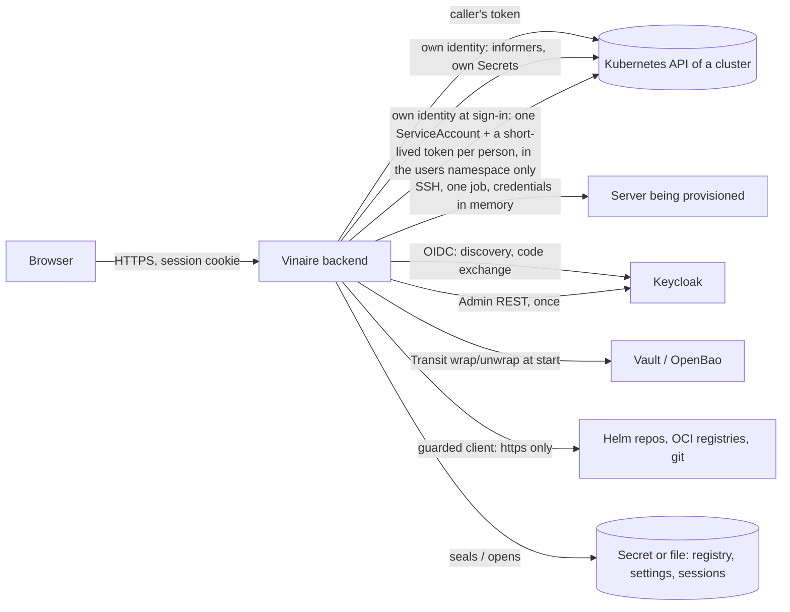

# Vinaire — security review package

**English** · [Русский](./security-review.ru.md)

For whoever reviews or pen-tests Vinaire before it is reachable outside a trusted network
(Roadmap Phase 50). Scanners (govulncheck, gosec, npm audit, gitleaks, Trivy, ZAP) are already
in CI; they do not find *logic* flaws — a wrong permission check, an identity mix-up, a missing
gate. This document points a human at the places where such a flaw would matter most, says
what is already proven by tests so the time goes elsewhere, and says what is out of scope.

Read [security.md](./security.md) first (threat model, verified properties, residual risks), then
[AGENTS.md](../AGENTS.md) (the rules every change is held to) and [api-routes.md](./api-routes.md)
(every HTTP route, generated from the router).

## 1. What Vinaire is, in one paragraph

A web UI in front of Kubernetes clusters. A Go backend (chi, client-go) serves a static
Next.js export and a JSON/WebSocket API. Almost every call runs **as the signed-in user**: their
Kubernetes token (a pasted ServiceAccount token, a short-lived ServiceAccount token Vinaire obtained for a person who signed in through Keycloak, or — only when the API server trusts the issuer — an OIDC ID token) sits server-side behind an
opaque, HttpOnly session cookie and is used for the call, so the cluster's RBAC — not Vinaire —
decides. Vinaire holds credentials of the clusters registered in it (sealed at rest) and has a few
actions that run with its **own** identity (live-update informers, its own settings, background
GitOps).

## 2. Trust boundaries



Untrusted: the browser and everything it sends; **all data read from clusters** (names, labels,
log lines — rendered as text only); Helm repositories, registries and git repositories; a
Keycloak URL typed into the wizard. Trusted (operator configuration): environment variables, the
chart's values, the key provider's address.

## 3. Critical paths — where to spend the time

For each: the code, the property to try to break, and what the tests already prove.

| Path | Code | Try to break | Already proven |
|---|---|---|---|
| **Sign-in and sessions** | `internal/authn` | log in as someone else; keep a session after logout/expiry/revoke; fixation; brute-force; read another session; confuse token and OIDC modes; the run-time Keycloak switch | session id entropy and rotation, cookie flags, throttle, 12 h cap, shared store holds no readable token or id, revoke reaches all replicas, token login can't be switched off while OIDC is off |
| **Identity broker (Keycloak sign-in by ServiceAccount)** | `internal/oidcbroker`, `internal/authn/oidc.go`, chart `templates/users-namespace.yaml` | get more than the person has: reuse another person's account, make Vinaire create a binding or a role, mint a token outside the users namespace, read a Secret with the broker's Role | the broker creates ServiceAccounts and tokens only and never a binding (`TestFirstSignInCreatesAnAccountWithNoRightsAndATokenForIt`); a same-named account that is not ours is never adopted; the chart's Role is shown on a real cluster to stop at its namespace (`integration/broker_test.go`); deleting an account ends its tokens in seconds; an http Keycloak can't be paired with the API-server mode. **Known limit:** the key is the OIDC subject alone (Roadmap Phase 82 adds the issuer) |
| **Authentication coverage** | `backend/router.go` | find a route that answers without a session | `TestEveryRouteNeedsASessionExceptTheSignInFlow` walks the router; the six public routes are named with reasons |
| **Per-user authorization** | `internal/api/*`, `internal/stream/authz.go` | read or change what the caller's RBAC forbids; reach a cluster with Vinaire's identity instead of theirs | handlers use the caller's `rest.Config`; the live stream is filtered per event; the "caller's token, never the backend's" tests |
| **Exec / terminal** | `internal/stream/exec.go` | open a shell without `pods/exec`; keep one after logout; bypass the origin check | start **and** end are audited; origin check on every WebSocket (a test fails the build otherwise) |
| **Secret reveal** | `internal/api/secrets.go` | read a value without the audited endpoint; skip the audit | values only via `reveal`, as the caller, audited; list endpoints return metadata only |
| **YAML apply** | `internal/api/apply.go`, `internal/k8s/apply.go` | write something the caller isn't allowed to; apply two documents; smuggle a Secret placeholder; skip the dry-run/resourceVersion check | exactly one document, size cap, strict fields, dry-run first, 409 on a stale resourceVersion; `FuzzParseSingleManifest` |
| **SSH provisioning** | `internal/provision`, `internal/api/provision.go` | get a command executed that the user didn't type; reach loopback/metadata; leak a credential; skip host-key pinning | strict patterns + single-quoting (`FuzzShQuote`, `FuzzProvisionValidators`), `ValidateTarget`, host-key pinning, `Secret` redaction, the canary test |
| **Registry / key storage** | `internal/clusters` | open the store without the key; swap or downgrade it; find a credential in a log or response | AES-256-GCM, key rotation, key provider (wrapped key only, fail-closed), canary test, `FuzzParseKubeconfig` |
| **Keycloak wizard** | `internal/keycloak`, `internal/api/keycloak.go` | make Vinaire talk to an internal address; lock everyone out; read the client secret or admin password back | guarded client, `auth.vinaire.io` gate, unencrypted store refused, secrets never returned, `FuzzParamsValidate` |
| **Helm install** | `internal/helm`, `internal/api/catalog.go` | install something with more rights than the caller; name a repository/URL in a request; skip the digest check | caller's `rest.Config`, repositories only from configuration, sha256 verified, preflight |
| **GitOps (native)** | `internal/gitops` | apply as Vinaire instead of the supplied ServiceAccount; leak the tokens; read outside the source path | per-source ServiceAccount token, sealed, `netguard`, in-memory git |
| **Port-forward proxy** | `internal/api/portforward.go` | reach a pod the caller can't; get the session cookie to a pod; script on Vinaire's origin | caller's identity, CSP `sandbox`, cookies not forwarded, `FuzzParseProxyTarget` |
| **Web security** | `backend/security_headers.go`, `internal/api/origin.go`, frontend | XSS from cluster data; CSRF; clickjacking; CSP bypass | CSP by hash, origin guard on every state-changing route and WebSocket, ESLint bans HTML sinks, browser checks in CI |
| **Multi-replica** | `internal/authn/shared.go`, `internal/leader` | forge or replay a session via the shared Secret; make two replicas apply at once | sealed + hashed keys, leader Lease |

## 4. What is checked automatically (so a reviewer needn't repeat it)

* **Every route needs a session** except the named sign-in routes, **every state-changing route is
  rate limited** except the named ones (`backend/router_test.go`); `docs/api-routes.md` is regenerated
  from the router and a test fails when it is stale.
* **Every request body is size-limited** (`TestEveryRequestBodyIsSizeLimited`).
* **Codebase rules** (`backend/codebase_rules_test.go`): no `InsecureIgnoreHostKey`, TLS verification
  skipped only in three reviewed places, WebSocket origin checks, and more.
* **Fuzzing** (Security workflow, 30 s per target on every run; seeds run on every build):
  kubeconfig parsing, cluster server URLs, token/key parsing, single-document YAML, proxy targets,
  node label/taint and RBAC-binding validation, shell quoting and the SSH-install validators, the
  metrics-stack options (YAML injection), the Keycloak parameters.
* **Canary test:** a marker placed in every credential-carrying field never reaches a log or an
  error response.
* **Supply chain:** SBOM (CycloneDX) for the repository on every run and for each released image;
  released images are signed with cosign (keyless) with a provenance attestation
  (`.github/workflows/release.yml`); third-party actions are pinned by commit.

## 5. What is *not* covered — please look here

* **Authorization is delegated to Kubernetes.** A correct Vinaire cannot tell that a ClusterRole is too
  generous. Review the roles the chart ships (`charts/vinaire/templates/clusterrole.yaml`).
* **The browser side beyond the CSP/XSS checks:** a manual pass over `dangerouslySetInnerHTML`-free rendering
  of cluster data, the Monaco/xterm integrations and the `postMessage`-free design.
* **Race conditions and logic across handlers:** session creation vs. revocation; the order of the
  token/OIDC switch; the registry's read-modify-write; the apply dry-run → write gap.
* **Denial of service:** per-identity write limits exist; the read side, WebSocket counts and the
  informer fan-out have caps but have not been load-tested.
* **The deployment around it:** ingress, TLS, NetworkPolicy enforcement by the CNI (the policy renders and is
  accepted, enforcement was not verified), Vault/KMS policy, who can read Vinaire's namespace.

## 6. Running everything yourself

```bash
cd backend
go build ./... && go vet ./... && go test ./...                 # includes the route and rule tests
gosec -severity medium -confidence medium ./...
govulncheck ./...
go test ./internal/clusters -run '^$' -fuzz FuzzParseKubeconfig -fuzztime 2m   # any Fuzz* target
UPDATE_ROUTES=1 go test . -run TestRouteInventory                              # regenerate docs/api-routes.md
cd ../frontend && npm run lint && npm run check:i18n && npm audit
```

A disposable cluster for dynamic testing: `k3d cluster create vinaire-sec` and the chart's
`examples/values-local.yaml`; `keycloak/docker-compose.yml` gives a Keycloak to exercise the wizard.
Do not point tests at a cluster that holds anything you care about: Vinaire can restart, scale and delete
what the token it is given may.

## 7. Reporting

Please send, for each finding: the route or file, the steps to reproduce, the identity used (which RBAC),
the impact in terms of the properties in [security.md](./security.md), and a suggested fix if you have one.
Findings that are accepted as residual risks go into the "Known residual risks" list there; the rest become
issues with a regression test.
